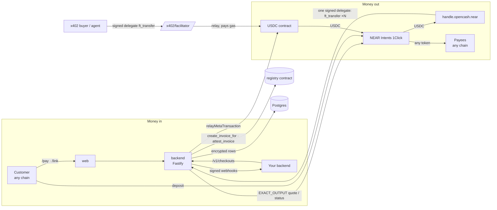

<div align="center">

# opencash

### Remittance for open worlds.

*Payments infrastructure on NEAR: any chain in, any chain out, settled in USDC.*

*Invoices, payment links and a checkout API that accept any token on any chain; payouts and payroll to any chain; signed webhooks. Built on NEAR Intents, NEP-366 meta-transactions, passkeys and a Rust registry contract.*


</div>

## What is opencash?

A business with global customers and contractors is stuck between chains. Customers hold USDC on Base, ETH on Arbitrum, SOL or BTC. Contractors want to be paid on whatever chain they use. Accepting all of that, paying people back out, and keeping books an accountant can read normally means bridges, several wallets and gas tokens on every chain.

opencash gives a business one USDC account on NEAR, opened with a passkey. Money comes in from any chain through invoices, payment links or the checkout API, and always lands as exact USDC. Money goes out as payouts or payroll, and each recipient receives the token and chain they choose. NEAR Intents does the routing in both directions. Every invoice outcome is recorded on NEAR, every change fires a signed webhook, and every list exports as a CSV.

Five ways in:
- **Web app** (Astro): landing page at `/`, the dashboard at `/app`, and public pages `/pay?id=…` (pay an invoice), `/link?id=…` (payment link) and `/sign?id=…` (sign an agreement)
- **Mobile app** (Expo / React Native): balance, invoices, payouts and agreements, with the same passkey
- **HTTP API**: `POST /v1/checkouts`, `POST /v1/invoices`, `GET /v1/invoices/:id` with API keys
- **Webhooks**: `invoice.*` and `payout.*` events, HMAC-signed and retried
- **Chat**: a Telegram bot and an XMTP agent: `pay Ada 50 USDC on base to 0x…`, `request 120 from Northwind`, `balance`, `status`, with delivery updates pushed into the chat

> The differentiator: one account and one signature cover both directions across chains. There is no seed phrase and no gas token to buy, and opencash never holds keys or funds. The account key is derived from a passkey, and opencash only pays gas for registry calls and for USDC transfers to deposit addresses it quoted for that account.

## For bookkeepers: how to read opencash

Everything is priced in **US dollars** and settles in **USDC**, a stablecoin worth $1.00. You never need to price crypto.

### Invoice statuses (money in)

| Status | Meaning | Money received? |
| --- | --- | --- |
| **Waiting** (`open`) | Invoice sent; the customer hasn't started paying. | No |
| **Payment in flight** (`pending`) | The customer asked for a deposit address and the payment is being processed (seconds to about 15 minutes). | Not yet |
| **Paid** (`paid`) | The full invoice amount arrived as USDC. Final; it can't change afterwards. | **Yes, on the "Paid date"** |
| **Refunded** (`refunded`) | The payment couldn't complete and went back to the customer. The reason is recorded. | No |

If a payment attempt fails outright, the invoice goes back to **Waiting** so the customer can try again. Record income on the **Paid date** for the **Invoice amount (USD)**. The customer pays their own conversion and network costs on top.

### Payout statuses (money out)

| Status | Meaning |
| --- | --- |
| **In flight** (`sent`) | USDC left the business account; NEAR Intents is delivering it. |
| **Delivered** (`completed`) | The recipient received the token on their chain. |
| **Refunded** / **Failed** | Delivery didn't complete; the USDC is refunded to the business account. |

Record the expense on the payout date for **Sent (USDC)**.

### Invoice CSV, column by column

| Column | What it is |
| --- | --- |
| Invoice ID | Unique number, e.g. `acme-3` |
| Client | Who was billed |
| Issue date / Due date / Paid date | ISO dates (YYYY-MM-DD). Paid date is empty until the status is `paid`. |
| Description | Line items, separated by `;` |
| Invoice amount (USD) | What was billed |
| Received (USDC) | What arrived. Equals the invoice amount when paid, empty otherwise. |
| Status | `open`, `pending`, `paid` or `refunded` |
| Client paid with | The token and chain the customer used, e.g. `USDC on arb` (Arbitrum) |
| Amount client sent / Client sent (USD) | What the customer actually sent, including their costs |
| Payment transaction (client's chain) | Public link proving the customer sent the payment |
| Settlement transaction (NEAR) | Public link proving the USDC arrived |
| Received by | The business account |
| Refund reason | Only for refunded invoices |

### Payroll CSV

One row per payout: ID, date, batch, recipient, **Sent (USDC)**, what the recipient received (amount, token, chain), their address, status, the NEAR transfer transaction, the delivery transaction on their chain, and the refund reason if any.

## Features

### Get paid from any chain
- **Invoices**: client, due date and line items, stored in the registry contract with the total computed on chain. Created by a gasless meta-transaction
- **Payment links** (`/link?id=…`): reusable, with a fixed or open amount. Each payment becomes an on-chain invoice, so it gets the same status, CSV row and webhooks
- **Checkout API**: `POST /v1/checkouts` returns a `pay_url` for your customer
- **Pay page**: the customer picks a token and chain and gets an `EXACT_OUTPUT` NEAR Intents (1Click) quote, so the business receives exactly the amount due
- **Trustworthy status**: `open → pending → paid / refunded`, written to the contract after 1Click reports the outcome, with links to both chains. A watcher checks in-flight invoices every 20 seconds, so nobody has to keep a page open

### Pay out to any chain
- **Payouts**: pick a recipient's chain, token and address and enter an amount in USD. opencash gets an `EXACT_INPUT` quote from USDC on NEAR and registers the 1Click deposit address with USDC, paying that storage itself. The business then signs one gasless USDC transfer with its passkey
- **Payroll**: up to 20 people in **one passkey signature**, entered by hand, from saved payees, or imported from a CSV (`name, amount, chain, token, address`). Payroll CSV export
- **Delivery tracking**: payouts move `sent → completed / refunded / failed` with links to the NEAR transfer and the delivery on the recipient's chain. Quotes expire after 60 minutes
- **Saved payees**: recipients are remembered after a successful send

### Pay and get paid by NEAR name
- **Direct payouts to `alice.near`**: USDC to any NEAR account in one gasless transfer, with no NEAR Intents fee and done in about 2 seconds. Works from the dashboard, payroll CSV, chat (`pay alice.near 50`) and agent wallets. Native NEAR is offered as `wNEAR`
- **Pay an invoice from a NEAR wallet**: the payer sends USDC to the registry with the invoice ID (`ft_transfer_call`). The contract checks the amount, marks the invoice paid, forwards the USDC to the business in the same transaction, and returns any excess. If forwarding fails, the invoice is restored and the payer is refunded automatically

### AI agent wallets
- **An isolated spending account per agent**: `agent-<name>-xxxx.<business>.opencash.near`, created by one gasless passkey signature from the business. The agent has its own USDC balance; it can never touch the business's main account
- **Budgets enforced before every signature**: per-payment cap, rolling 24-hour cap, an allowlist of NEAR accounts or API hosts, and freeze. Spending is reserved under a database lock, so concurrent calls can't overspend
- **Agent API** with its own key: `GET /v1/agent`, `POST /v1/agent/pay {to, amount}`, `POST /v1/agent/fetch {url}`, `POST /v1/agent/payments/:id/redeem`. `fetch` pays x402 paywalls in USDC on NEAR by either of two methods:
  - **Direct NEAR (`exact`, `@fastnear/x402`)**: the agent signs a NEP-366 delegated `ft_transfer` to the seller, and the seller's facilitator relays it and pays gas
  - **NEAR Intents (`exact` + `assetTransferMethod: near-intents`, e.g. [PingPay Agent Pay](https://pingpay.gitbook.io/docs/pingpay-api/agent-pay-facilitator/x402-integration.md))**: the agent asks for a quote with itself as `refundTo`, checks the **quoted** amount against its caps, sends USDC to the single-use 1Click deposit address, then presents the deposit until the seller's facilitator confirms delivery. The seller can receive any token on any chain. If settlement is still running after about a minute, `fetch` returns `202 {pending: true, payment_id}`, and the agent calls `redeem` later instead of paying again (a second payment to the same URL is refused while one is settling). A refunded swap is marked `refunded` and no longer counts against the caps
  - The fetch endpoint refuses non-HTTPS, private or internal addresses, and redirects
- **Owner controls**: fund, change limits, freeze, sweep the balance back, rotate the agent key, and see every payment with its transaction
- **Trust model, stated plainly**: opencash holds each agent's key (encrypted with AES-256-GCM) and enforces the caps. On chain, only the agent's balance limits what it can lose. NEAR function-call keys can't send USDC (they can't attach the 1 yoctoNEAR deposit), so on-chain caps would need a policy contract per agent; see [docs/agents-and-contract-research.md](docs/agents-and-contract-research.md)

### Developer platform
- **API keys**: shown once, stored as SHA-256 hashes, revocable, last-used tracking
- **REST API**: `POST /v1/checkouts`, `POST /v1/invoices`, `GET /v1/invoices/:id`, `GET /v1/invoices?status=`. API-created invoices carry `source: "api"` and your `reference`
- **Webhooks**: `invoice.pending`, `invoice.paid`, `invoice.refunded`, `invoice.failed`, `payout.sent`, `payout.completed`, `payout.refunded`, `payout.failed`, `agent.payment`, `x402.paid`, plus `test.ping`. Signed as `Opencash-Signature: t=<unix>,v1=<HMAC-SHA256(secret, "t.body")>`. Deliveries are queued in Postgres and retried after 1, 5, 30 and 120 minutes, and the last attempts are visible in the dashboard
- **Sell with x402 (opencash as facilitator)**: `GET /x402/facilitator/supported`, `POST /x402/facilitator/verify`, `POST /x402/facilitator/settle` (API key). Point any x402 v2 resource server, e.g. `createNearResourceServer` from `@fastnear/x402/server`, at `<api>/x402/facilitator`. Buyers sign a gasless USDC `ft_transfer` on NEAR; opencash's relayer submits it and pays the gas. The relayer only sponsors `exact` USDC payments on `near:mainnet` whose `payTo` is the API key's own business, of at least 0.01 USDC, and at most 600 settlements per business per hour. Each sale is recorded, shown under **Developers**, and sent as an `x402.paid` webhook
- **Payouts stay out of the API on purpose**: sending money needs the owner's passkey, and opencash never holds keys

### Remittance from a chat
- **Telegram bot and XMTP agent** share one command set: `link`, `balance`, `pay <name> <amount> [token] [on <chain>] [to <address>]`, `pay <saved payee> <amount>`, `request <amount> from <name> [for <what>]`, `status`, `unlink`
- **Non-custodial by design**: the chat never holds keys. `pay …` returns a quote and a link to `/send?ids=…`, where the owner signs with their passkey. `request …` returns a pay link anyone can pay from any chain
- **Linking**: `link` returns a one-time, 15-minute code; opening `/chat-link?code=…` and signing a NEP-413 message binds the chat to the account
- **Updates in the chat**: payment received, payout sent, payout delivered or refunded, through a Postgres outbox with retries
- **Why these platforms**: plain Telegram bots may link to any chain (only Mini Apps are TON-only), and XMTP is an open protocol. WhatsApp's Commerce Policy restricts crypto and financial services, so it's on the roadmap only as a licensed, fiat-facing product

### Account and signing
- **Passkey account**: the passkey's PRF output is run through HKDF to make an ed25519 NEAR key. The same passkey gives the same key on every device it syncs to, and nothing is stored
- **Named business account**: `handle.opencash.near`, created by the backend with your passkey key and registered with USDC
- **Gasless**: NEP-366 meta-transactions through an allowlisted relayer

### Optional: US company formation and agreements
- **Formation intake**: the same details doola and Stripe Atlas collect (you, company, owners, IRS SS-4 questions), with a NEAR AI advisor that suggests a Wyoming LLC or a Delaware C-Corp. Answers are encrypted in Postgres; only their SHA-256 goes on NEAR. Payments work without this
- **Agreements signed with NEAR keys**: an Operating Agreement or Bylaws generated from the intake, a client service agreement generated from an invoice, or any uploaded PDF. Each party signs the document's SHA-256 with their own NEAR account key (a NEP-413 message, verified against the key on chain), using an opencash passkey or any NEAR wallet via `@hot-labs/near-connect`. No transaction or gas needed

## Architecture



| Component | Role | Backed by |
| --- | --- | --- |
| `contracts/registry` | Businesses, invoices (direct, link, API, chat), statuses, NEAR-wallet payment with forward and refund | NEAR contract state |
| `backend` | Accounts, relayer, inbound quotes, payouts, links, API keys, webhooks, watcher | Fastify, `near-api-js` 7.5.3, 1Click, Postgres |
| `web` | Landing page, dashboard, pay / link / sign pages | Astro, WebAuthn PRF, `near-connect` |
| `mobile` | Balance, invoices, payouts, agreements, optional formation | Expo, `react-native-passkey` PRF |
| `packages/shared` | Types, passkey key derivation, API + 1Click clients, CSV, intake validation | `@noble/curves`, `@noble/hashes` |

### Registry contract methods

| Method | Who can call | What it does |
| --- | --- | --- |
| `new(operator, usdc)` | deployer, once | sets the operator and the USDC token |
| `register_company(account_id, legal_name, country)` | operator | records a business |
| `create_invoice(client_name, due_ms, items)` | the business (relayed) | invoice with `source: direct`, total computed on chain |
| `create_invoice_for(company, client_name, due_ms, items, source, reference?)` | operator | invoice created from a payment link or the API |
| `attest_invoice(id, status, deposit_address?, settle_tx?, payment?)` | operator | records the outcome, paid date and what the customer paid with; `paid` is final |
| `list_pending`, `get_invoice`, `list_invoices` | anyone (view) | reads |
| `ft_on_transfer(sender_id, amount, msg = invoice id)` | the USDC contract only | NEAR-wallet invoice payment: check the token, invoice and amount, mark paid, forward to the business, return any excess; refund everything if forwarding fails |
| `record_settlement(id, settle_tx)` | operator | records the wallet payment's transaction hash, once, after the backend verifies it on chain |

### Where data lives

| Data | Where | Survives restart |
| --- | --- | --- |
| Invoices (all sources), statuses, paid date, customer payment details, transaction links | NEAR contract | yes |
| USDC balances, payout transfers | USDC contract on NEAR | yes |
| Payouts, payroll batches, payees, payment links | Postgres | yes |
| Chat links, one-time link codes, chat outbox (pending messages resume) | Postgres | yes |
| API keys | Postgres, SHA-256 hash only | yes |
| Webhook endpoints (secret encrypted) and delivery queue | Postgres | yes; pending deliveries resume |
| Formation applications and agreement documents | Postgres, AES-256-GCM | yes |
| Formation status, entity, application hash (optional) | Postgres `formations` | yes |
| Agreements and NEP-413 signatures (account, public key, message, nonce, signature) | Postgres `agreements`, `agreement_signatures` | yes |
| Agent wallets (encrypted key, caps, allowlist, status) and agent payments | Postgres `agents`, `agent_payments` | yes |
| NEAR Intents x402 operations (quoted entry, operation token, deposit tx, facilitator receipt) | Postgres `agent_payments.operation`, `.receipt` | yes; a pending payment can be redeemed after a restart |
| x402 sales settled by opencash's facilitator | Postgres `x402_settlements` | yes |
| Facilitator duplicate-settlement guard | backend memory (`@x402/near` cache) | no; the on-chain nonce still stops a double spend |
| Account signing key | nowhere; re-derived from the passkey | n/a |
| Token list cache, rate limits, watcher "already running" flag | backend memory | no (rebuilt) |

## Project structure

```
.
├── contracts/registry/            Rust registry contract + 16 unit tests
├── backend/
│   ├── db/0{01..10}_*.sql         migrations: applications, documents, payouts, developer, chat, formations, agents, x402
│   └── src/
│       ├── index.ts               HTTP routes (/api/*, /v1/*)
│       ├── relayer.ts             meta-transaction allowlist (registry calls, quoted USDC payouts)
│       ├── payments.ts            inbound quotes, status → attestation, invoice watcher
│       ├── payouts.ts             payout quotes, deposit registration, delivery watcher, payees
│       ├── developer.ts           payment links, API keys, webhooks (sign, queue, retry)
│       ├── agents.ts              agent wallets: caps, pay, x402 fetch (direct + NEAR Intents), redeem, sweep
│       ├── intents402.ts          x402 near-intents payloads (quote, deposit, receipts)
│       ├── facilitator.ts         opencash x402 facilitator on the operator relayer
│       ├── chat/                  core.ts (commands) · outbox.ts (links, notifications) · telegram.ts · xmtp.ts
│       ├── nearAuth.ts            NEP-413 request authentication
│       ├── applications.ts · documents.ts · templates.ts · advisor.ts   optional formation + agreements
│       ├── near.ts · vault.ts · db.ts · config.ts
│       └── *.check.ts             runnable checks
├── web/src/pages/                 index (landing) · app · pay · link · sign · send · chat-link
├── mobile/src/screens/            Start · Home · Invoices · Payouts · Company · Formation · Account
├── packages/shared/               types, passkey→NEAR key, API + 1Click clients, CSV, intake
└── docs/                          near-integration-brief.md · formation-research.md
```

## Setup

Requirements: Node 22+, pnpm 9 (`corepack pnpm`), Docker (Postgres), Rust with `cargo-near` for the contract.

1. Install
   ```bash
   corepack pnpm install
   ```
2. Run the checks that need no NEAR keys
   ```bash
   (cd contracts/registry && cargo test)
   (cd packages/shared && npx tsx src/passkey.check.ts && npx tsx src/csv.check.ts && npx tsx src/intake.check.ts)
   (cd backend && corepack pnpm check)        # relayer allowlist incl. payout rules + live 1Click dry quote
   ```
3. Start Postgres and migrate
   ```bash
   docker run -d --name opencash-postgres -e POSTGRES_PASSWORD=opencash -e POSTGRES_DB=opencash -p 127.0.0.1:5440:5432 postgres:16
   cp backend/.env.example backend/.env       # then fill it in, see below
   (cd backend && corepack pnpm db:migrate)
   (cd backend && npx tsx --env-file=.env src/developer.check.ts && npx tsx --env-file=.env src/applications.check.ts)
   ```
4. Build and deploy the registry (spends about 3.5 NEAR from `PARENT_ACCOUNT`)
   ```bash
   (cd contracts/registry && cargo near build non-reproducible-wasm)
   (cd backend && corepack pnpm deploy:registry)
   ```
5. Run
   ```bash
   corepack pnpm backend     # http://localhost:8787
   corepack pnpm web         # http://localhost:4321
   corepack pnpm mobile      # Expo; set EXPO_PUBLIC_BACKEND_URL, EXPO_PUBLIC_WEB_URL, EXPO_PUBLIC_PASSKEY_DOMAIN
   ```

| Variable | What it does |
| --- | --- |
| `PARENT_ACCOUNT` | mainnet account that owns `*.opencash.near`, acts as operator and relayer, and pays for deposit-address USDC registration |
| `CONTRACT_ID` | registry account, a direct sub-account of `PARENT_ACCOUNT` |
| `OPERATOR_PRIVATE_KEY` | full-access key of `PARENT_ACCOUNT` (`ed25519:…`) |
| `X402_RELAYER_PRIVATE_KEY` | optional second full-access key of `PARENT_ACCOUNT` for the x402 facilitator, so its transactions don't race the operator's nonce; falls back to `OPERATOR_PRIVATE_KEY` |
| `DATABASE_URL` | Postgres for payouts, links, API keys, webhooks, applications, documents |
| `APPLICATION_KEY` | 32-byte base64 key that encrypts webhook secrets, applications and documents |
| `PUBLIC_WEB_URL` | base for `pay_url` and link URLs returned by the API |
| `ONECLICK_JWT` | optional partner key from partners.near-intents.org (lower fees) |
| `NEAR_AI_API_KEY`, `NEAR_AI_MODEL` | optional formation advisor (`Qwen/Qwen3.6-35B-A3B-FP8` by default) |
| `NEW_ACCOUNT_NEAR` | NEAR sent to each new business account (default `0.01`) |
| `WATCH_INTERVAL_MS` | invoice and payout watcher interval (default `20000`) |
| `TELEGRAM_BOT_TOKEN` | optional; token from @BotFather to run the Telegram bot (long polling, no public URL needed) |
| `XMTP_WALLET_KEY`, `XMTP_DB_ENCRYPTION_KEY`, `XMTP_ENV`, `XMTP_DB_DIRECTORY` | optional; run the XMTP agent (`XMTP_ENV=production` for the Base app and other XMTP apps) |

## Try it (do X, see Y)

> **Dev mode** (only under `pnpm web`, never in production builds): `/app` shows **Dev mode · skip passkey**. It uses a fixed development key and the real account `dev.opencash.near`, so it needs the registry deployed. There is no sample data.

1. Open http://localhost:4321 and click **Launch app**. Enter your name, business name, handle `acme` and country, then click **Create my account with a passkey**. **See** the dashboard with a USDC balance card for `acme.opencash.near` and four colored quick actions.
2. **Get paid by invoice:** click **New invoice**, add `Design sprint` / `5.00`, and **Create invoice**. Open the pay link in a private window, pick `USDC on arb`, add a refund address, and click **Get deposit address**. **See** an exact amount and a QR code. After paying, **see** the invoice turn **Paid** within about 20 seconds, with links to both chains.
3. **Get paid by link:** in **Links**, create `Consulting hour` with no amount. Open the copied `/link?id=…`, enter a name and `25`, and click **Continue to payment**. **See** the same pay page for a new invoice that the dashboard marks as coming from a link.
4. **Pay someone:** in **Payouts → One person**, pick `USDC on base`, paste an address, enter `2.00`, and click **Get quotes**. **See** what the recipient will receive. Tick the confirmation and click **Send with passkey**. **See** the payout move to **Delivered**, with the NEAR transfer and the Base delivery linked.
5. **Run payroll:** switch to **Payroll** and import a CSV (`name,amount,chain,token,address`). Click **Get quotes**, then **Send with passkey**. **See** one signature send everyone their own token and chain. Click **Export CSV**.
6. **Build on it:** in **Developers**, create an API key and add a webhook URL. Run the `curl` in the quickstart to create a checkout. **See** a `pay_url` in the response, and `invoice.pending` / `invoice.paid` deliveries listed under the endpoint once it's paid. Click **Send a test event** to see `test.ping`.
7. **Remit from a chat:** set `TELEGRAM_BOT_TOKEN`, restart the backend, and message the bot `link`. Open the link and sign in. Then send `pay Ada 2 USDC on base to 0x…`. **See** a quote and a signing link; sign it, and **see** "Sent…" and then "Delivered…" appear in the chat. Send `request 25 from Northwind` and **see** a pay link.
8. Export the invoice CSV and the payroll CSV, and read them with [the bookkeeper guide](#for-bookkeepers-how-to-read-opencash).

## Security & trust

- **Non-custodial**: the account key never leaves the device and is never stored; it is re-derived from the passkey's PRF output. opencash cannot move a business's USDC.
- **Relayer allowlist** (`backend/src/relayer.ts`, tested in `relayer.check.ts`): it pays gas only for (a) `create_invoice` on the registry, with no deposit and at most 100 TGas, and (b) USDC `ft_transfer`s from `*.opencash.near` whose memo names a payout opencash recorded **for that same account**, to that payout's exact address (1Click deposit address or NEAR name), for the **exact amount**, before it expires, with exactly 1 yoctoNEAR attached (the relayer pays that deposit, so it is capped), each payout once; and (c) creating an agent: a direct sub-account with exactly `CreateAccount + AddKey` of the key opencash generated for that pending agent. Anything else gets a 403.
- **API keys** are shown once and stored as SHA-256 hashes. **Webhook secrets** are encrypted with AES-256-GCM. Webhook URLs must be https (localhost is allowed for testing).
- **Dashboard requests** that read private data (payouts, payees, links, keys, webhooks, documents) need a fresh NEP-413 signature from the account's full-access key.
- **Only the operator** can attest invoice outcomes or create link/API invoices. `paid` is final.
- **NEAR-wallet payments** are enforced by the contract itself: only the real USDC contract can pay, underpayments and paid invoices are refused, and a failed forward refunds the payer.
- **x402 facilitator**: sponsors only USDC payments on NEAR to the API key's own business (min 0.01 USDC, 600 per hour), so a leaked key can't make opencash pay gas for other people's transfers. `@x402/near` checks the signature, the key, the amount, the recipient and the payer's balance before relaying.
- **Agent wallets** are custodial for the agent's budget only (see above). Every agent payment passes the cap, allowlist and freeze checks first.
- **Rate limits**: account opening is limited to 3 per IP per hour, and payment-link invoice creation to 20 per IP per hour.
- The operator key and the encryption key live only in `backend/.env`, which is gitignored.

## Status

| Item | State |
| --- | --- |
| Contract unit tests (16): invoices, operator invoices (link, API, chat), attestations, NEAR-wallet payment (exact, wrong token, short, unknown, already paid, overpayment, failed forward refund), settlement recorded once | ✅ `cargo test` |
| Contract wasm build (slimmed: formation and agreements moved off chain) | ✅ 207 KB |
| Relayer allowlist incl. payout attacks (unquoted address, changed amount, missing yocto, reused address, another account's quote) | ✅ `relayer.check.ts` |
| 1Click `EXACT_OUTPUT` inbound quote | ✅ live dry quote (Arbitrum USDC → 5.00 NEAR USDC) |
| 1Click NEAR-origin payout quote (deposit address needs USDC registration, which opencash pays) | ✅ live quote inspected; no funds moved |
| API keys (hash only, revoke), webhooks (HMAC verifiable, retry then deliver), payment links (create, disable, amount validation) | ✅ `developer.check.ts` against Postgres |
| API key rejection over HTTP (missing, malformed, unknown) | ✅ |
| Invoice and payroll CSV, payroll CSV import | ✅ `csv.check.ts` + manual parse check |
| Off-chain agreements (normalised parties, outsiders, double signing, execution, void, signature evidence) | ✅ `agreements.check.ts` |
| Agent wallets (per-payment and 24-hour caps, simultaneous payments at the cap, allowlist, freeze, encrypted key, hashed agent key, SSRF guard, agent-creation relay rule) | ✅ `agents.check.ts` |
| x402 NEAR Intents client (402 decoding, entry choice, quote and deposit payloads, receipts, redeem guards) and facilitator policy (wrong payTo, asset, network, below minimum, hourly cap) | ✅ `x402.check.ts` |
| PingPay facilitator accepts `near:mainnet` as an origin | ✅ live `GET /supported` |
| Agent against PingPay's real seller middleware (`@pingpay/agentpay-middleware` 0.2.0, Ping's facilitator simulated per the spec): quote → cap check on the quoted amount → deposit → `settlement_pending` → settled; over-cap quote refused before any transfer; refund; slow settlement → `202` → redeem without paying twice; refused quote reason | ✅ `pingpay.check.ts` (USDC transfer stubbed) |
| opencash facilitator against live mainnet RPC: a key the payer doesn't own and a changed amount are both rejected | ✅ `x402.check.ts` |
| Seller price `"$0.01"` → 10000 units of mainnet USDC (passes the facilitator's 0.01 minimum) | ✅ `@x402/near` server parser |
| Agent x402 payment against a live paywall (direct or PingPay) | ⏳ not yet run (needs a funded agent on mainnet) |
| opencash facilitator `verify`/`settle` with a real buyer (positive path) | ⏳ not yet run (needs `opencash.near` and a funded buyer) |
| PingPay's exact NEAR asset identifier in a live `/offers` | ⏳ needs a Ping merchant key; the client accepts both the bare and `nep141:`-prefixed USDC id |
| Chat: command parsing, one-time link codes, per-account notifications with retry, Telegram polling loop (simulated Telegram server) | ✅ `chat/chat.check.ts` |
| XMTP agent round-trip on the XMTP dev network (throwaway identities) | ✅ live message and reply |
| Telegram bot against the real Telegram API | ⏳ needs a `TELEGRAM_BOT_TOKEN` |
| Passkey key derivation, NEP-413 request auth, encrypted storage | ✅ `passkey.check.ts`, `documents.check.ts`, `applications*.check.ts` |
| Web, mobile and backend typecheck; web build; landing and dashboard in Chrome | ✅ |
| Registry deployed to mainnet | ⏳ needs `opencash.near` and about 3.5 NEAR |
| End-to-end paid invoice, payout, payroll, link payment and webhook on mainnet | ⏳ not yet run |
| Mobile app on a device | ⏳ typechecks only; passkeys need a domain with iOS/Android association files |
| Formation filing with a provider (doola / FileForms) | ❌ not wired; see [docs/formation-research.md](docs/formation-research.md) |

Known limits: if a payer requests a second quote for the same invoice, only the latest deposit address is tracked. Payouts can't be created through the API, because sending money requires the owner's passkey.

## Credits

The UI shell (landing page, theme tokens, gate, dashboard cards, mobile tab bar and components) is adapted from the team's earlier OpenCash app; all copy was rewritten for this product. The 1Click client in `packages/shared/src/intents` comes from the same codebase. Everything NEAR-specific was written during the hackathon.

## License

No license file committed yet.

<div align="center">
<sub>Built with <a href="https://near.org">NEAR</a> · <a href="https://docs.near-intents.org">NEAR Intents</a> · <a href="https://cloud.near.ai">NEAR AI Cloud</a> · <a href="https://astro.build">Astro</a> · <a href="https://expo.dev">Expo</a></sub>
</div>
