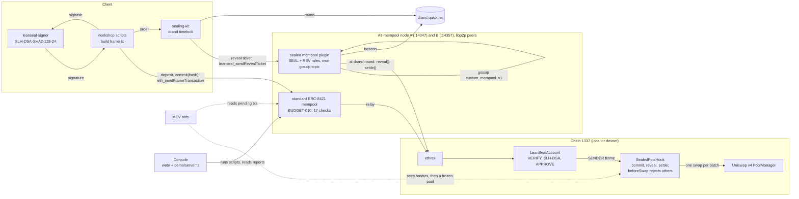

<div align="center">

# LeanSeal

### Quantum-safe wallets and sandwich-proof swaps on the EIP-8141 alternative mempool

*EIP-8141 frame transactions · ERC-8421 alternative mempools · NIST SLH-DSA (FIPS 205 family) · ML-KEM-768 (FIPS 203) · drand timelock · Uniswap v4*


Devnet explorer: [explorer.altmempool.wtf](https://explorer.altmempool.wtf/)

</div>

---

## What is LeanSeal?

When you swap on Ethereum, your signed transaction waits in a public mempool before a block includes it. Bots read it there and **sandwich** it: they buy just before you and sell just after, and you lose up to your whole slippage. Separately, the ECDSA key in today's wallets will not survive a large quantum computer.

LeanSeal combines two fixes, and uses no private submission anywhere:

- **A wallet that signs with NIST's hash-based post-quantum signature (SLH-DSA).** It is checked on-chain in an EIP-8141 VERIFY frame, at a cost only the alt mempool's staked budget allows.
- **A sealed batch auction for its swaps.**
  - The wallet commits only a hash of the order to a Uniswap v4 pool whose hook trades **only in batches**.
  - It gossips a drand-timelocked copy of the order on our **ERC-8421 sealed mempool**.
  - At the drand round, every node opens it and reveals it on chain. Then anyone settles the batch: buys and sells net at the pool price, the remainder is swapped once, and every order on a side gets **one price**.
  - The hook rejects every other swap, so there is no "before" or "after" to trade around.

> **Why it needs the alt mempool.** The SLH-DSA check costs about 150k gas, and EIP-8141's public mempool caps validation at 100k, so this wallet cannot use it at all. The ERC-8421 standard alt mempool gives staked entities 1M. LeanSeal runs a patched node that applies that budget, adds a **custom mempool** with its own published rules and its own gossip topic, and uses that mempool as the network that reveals sealed orders. On our local chain, the same swap lost **3.0%** to a sandwich bot on the public lane. In the batch auction it lost **0%** in three of three runs, and every front-run the bot tried was rejected by the pool.

**Ways in:**
- **Console:** an Astro dashboard at `/dashboard`. Pick a scenario, run it, and watch every admission check.
- **Scripts:** `workshop/src/pq`, `uni`, `leanseal` and `batch` deploy the wallet and pools, sign, swap, commit and run the MEV bots.
- **Library:** `sealing-kit/` seals envelopes and timelocks data to drand rounds.
- **Node:** the patched ERC-8421 mempool node in `sidecar/`, with the sealed mempool plugin from `leanseal-node/`.
- **CLI:** `signer/leanseal-signer` (SLH-DSA) and `signer-lss/lssk` (leanSphincs-s, for comparison).

---

## Features

### Quantum-safe wallet (`contracts/`)
- **`LeanSealAccount`** is an EIP-8141 smart account.
  - Its VERIFY frame reads an `ARBITRARY` signature with `SIGDATACOPY`.
  - It checks the signature against the protocol sighash (`TXPARAM 0x08`), then calls `APPROVE`.
  - The verifier is pluggable: any contract with `verify(pkSeed, pkRoot, message, sig)` works.
- **Stakes itself in its constructor.** Otherwise it could never stake, because the staking transaction would itself need the >100k check. Pass a stake of 0 for an unstaked wallet.
- **Built on SPHINCs-** (`SphincsFrameAccount`, the Yul frame module, and the NIST SLH-DSA-SHA2-128-24 verifier), vendored in `contracts/src/vendor/sphincs` (MIT). The leanSphincs-s verifier from the same repo is vendored too, for the comparison below.

### Fast SLH-DSA signer (`signer/`)
- **A fork of the C reference signer** with three changes:
  - Merkle and FORS trees are built on 16 threads;
  - it uses the ARMv8 SHA-256 instructions;
  - it can use an optional **XMSS cache**: the wallet's 2^22-leaf tree, built once (128 MiB of public hashes).
- **3.0 s per signature** with the cache, versus 354 s for the original signer. The output is byte-identical, and each signature is self-verified before it is printed.

### Sealed batch auction (`contracts/src/SealedPoolHook.sol`, `workshop/src/batch/`)
- **`SealedPoolHook`**, a Uniswap v4 `beforeSwap` hook on an ETH/tUSD pool. Its address carries exactly the beforeSwap flag; CREATE2 through `Create2Deployer` with a mined salt.
  - **Vault:** users `deposit()` first, separately, so the deposit does not reveal the trade.
  - **`commit(hash)`**: `keccak256(hook, user, round, zeroForOne, amountIn, minOut, salt)`. Rounds count blocks (4 blocks ≈ 24 s here).
  - **`reveal()`**: callable by anyone with the preimage, during the 2 rounds after the batch.
  - **`settle()`**: callable by anyone. Nets buys against sells at the pool price, swaps the remainder once, gives each side one price, refunds orders whose `minOut` the batch misses, and pays unrevealed bonds to the settler.
  - **`beforeSwap` reverts `OutsideSwap`** for every swap but the hook's own.
- **Alice's flow** (`batch_swap.ts`):
  - a PQ deposit, then a PQ commit (only the hash; it waits for a fresh round and retries if the commit lands late);
  - then a drand-locked reveal ticket sent to the sealed mempool;
  - proceeds land in her vault balance.
- **Batch bot** (`batch_bot.ts`): sees commits (hashes only) and reveals, then sends a real front-run through `SandwichSwapper`, which the hook rejects.

### Sealed mempool: an ERC-8421 custom mempool (`leanseal-node/`, `docs/leanseal-mempool.md`)
- **Published rule set, version 3.** The mempool id is the file's IPFS CIDv0, `QmSjNQxct8kRXMYKSsdefPsi3AFBHdSj3QjQtanS6bwgSc`, computed by `scripts/cidv0.py`.
- **Runs inside the alt-mempool node** through a new `customMempools` config hook, with **its own gossip topic** (`/account_abstraction/<id>/custom_mempool_v1/ssz_snappy`). Accepted messages are forwarded; invalid ones are not, and the peer is not penalised.
- **Reveal tickets** (`src/reveal.ts`, `src/hookChain.ts`):
  - admission rules `REV-010…060`: size, shape and pool, drand deadline, commitment on chain and unrevealed, duplicate, rate;
  - at the drand round, each node opens the ticket, checks it against the commitment, and calls `reveal()` and `settle()` from its own keeper key;
  - a peer that revealed first counts as revealed;
  - an unreachable drand retries instead of failing.
- **Sealed envelopes** (version 1 lane, kept for comparison):
  - signed transactions are timelocked and gossiped;
  - at the deadline every node releases them into the public mempool.
  - That hides a swap until the deadline but **does not stop a sandwich after it**, as measured below. The optional ML-KEM "chosen builder" lock is private order flow and is off by default.
- **An admission report for every message:** each `SEAL-*` or `REV-*` rule is recorded as pass, fail or skipped, with the source (`rpc` or `gossip`) and peer.

### Sealing kit (`sealing-kit/`)
- **Box:** the signed raw transaction, encrypted with AES-256-GCM. The label hash is the associated data.
- **Lock B:** the box key, timelocked to a drand quicknet round with `tlock-js`. `timelockSeal` / `timelockOpen` lock arbitrary bytes, used for reveal tickets.
- **Lock A (optional):** the box key wrapped for chosen builders with ML-KEM-768 + HKDF-SHA256.

### Patched alt-mempool node (`sidecar/`, upstream v4.1.1)
- **BUDGET-010:** if every entity in the validation prefix is staked, it may use up to 1,000,000 execution gas instead of 100,000 (`patches/sidecar-budget-010.patch`).
- **Precompiles allowed** (`0x01`–`0x11`, ERC-8421 CALLING-040), so the SLH-DSA verifier's SHA-256 call passes.
- **`customMempools`:** a generic hook for non-standard alt mempools. Each entry is a module exporting `createMempool({ mempoolId, options, gossip })` that serves its own RPC methods. Rule errors come back as JSON-RPC errors naming the rule.
- **Custom-mempool gossip:** a new gossipsub topic type `custom_mempool_v1` per mempool id (`CustomMempoolGossip`), wired into the node's p2p layer.

### Uniswap v4 swap (`workshop/src/uni/`)
- **ETH/tUSD v4 pool** (0.3% fee, no hook) seeded with about 0.01 ETH of full-range liquidity.
- **One frame transaction:** VERIFY (the PQ signature), then SENDER calling Universal Router `execute(V4_SWAP)` with `SWAP_EXACT_IN_SINGLE`, `SETTLE_ALL` and `TAKE_ALL`. Native ETH is sent as frame value, so no approvals are needed.

### MEV bot (`workshop/src/leanseal/mev_bot.ts`, `contracts/src/SandwichSwapper.sol`)
- **Watches** the public alt mempool and the sealed mempool, and decodes any readable swap on our pool.
- **Sandwiches it** with the largest front-run that still leaves the victim at exactly their minimum output.

### Console (`web/`, `demo/server.ts`)
- **Scenario presets:** MEV attack, Sealed swap, Live devnet tx, No-stake wallet.
- **Flags:** network, action, lane, scheme, MEV bot, slippage and verify gas. Combinations that cannot work are greyed out, with the reason.
- **Live run console:** Alice's and the bot's logs, quote / received / loss, and gas per frame.
- **Admission checks:** the 17-check ERC-8421 report per transaction, or the SEAL report per envelope, plus lifecycle events.
- **Sealed lane and PQ wallets tabs:** envelope history, SEAL verdicts of the last run, stake, balances and reputation.

| Console API (`demo/server.ts`, :4321) | Purpose |
|---|---|
| `GET /api/flags` | flag schema, defaults, presets |
| `POST /api/flags/check` | problems and per-option validity for a flag set |
| `POST /api/run` | start a run (one at a time) |
| `GET /events` | live run log (SSE) |
| `GET /api/status` | chains, services, wallets, reputation |
| `GET /api/runs` | last 50 runs (`demo/runs.json`) |
| `GET /api/admissions?network=` / `?mempool=sealed` | admission reports |
| `GET /api/tx/:hash`, `GET /api/envelope/:id`, `GET /api/mempool` | one tx, one envelope, sealed mempool info |

---

## Architecture



Every solid line has run on our local chain (two peered nodes) or the public devnet, or in tests. The dotted lines are the bots' watching. The older public-lane swap (Universal Router) and the sealed-envelope lane are not drawn.

| Component | Role | Backed by |
|---|---|---|
| `contracts/` | wallet, `SealedPoolHook`, `Create2Deployer`, test token, liquidity seeder, bot contract | Solidity 0.8.35, Foundry; SPHINCs- verifiers (MIT) |
| `signer/`, `signer-lss/` | SLH-DSA signer; leanSphincs-s signer | C with pthreads and ARMv8 SHA-256; Rust (`tiny-keccak`) |
| `sealing-kit/` | seal and open envelopes | `@noble/post-quantum`, `@noble/ciphers`, `tlock-js`, `drand-client` |
| `sidecar/` | ERC-8421 node with BUDGET-010 and `customMempools` | forshtat mempool-workshop-sidecar v4.1.1 (Bun, TypeScript) |
| `leanseal-node/` | sealed mempool plugin: envelopes, reveal desk | TypeScript, viem, sealing kit |
| `localnet/` | local chain 1337 | ethrex `eip8141-tracer` + Lighthouse via Docker Compose |
| `workshop/` | deploy, sign, swap, seal, bot | forshtat mempool-workshop, viem, `@forshtat/hegota-support` |
| `web/`, `demo/` | console UI and its API | Astro 5, Node `http` |

---

## Measured results

### MEV: the same swap on three lanes (local chain, bot watching)
Alice swaps 0.0001 ETH → tUSD with 3% maximum slippage, from the SHA2 wallet, through the console, while the bot attacks. Two alt-mempool nodes are peered over libp2p.

| | Public alt mempool | Sealed, public release | **Sealed batch auction** |
|---|---|---|---|
| Bot saw before execution | the whole swap | ciphertext until the drand deadline, then the whole swap | a hash; then a reveal, with the pool already closed to it |
| Bot did | front-run, back-run | front-run after release | tried to front-run → **rejected by the pool** (`OutsideSwap`) |
| **Alice's loss** | **2.9999%** (run #4) | **2.9999%** (run #13); 0% in run #12, where the bot's front-run happened to land after Alice | **0%** in 3 of 3 runs (#17, #19, #21) |
| Bot profit | 2,016,687,867,258 wei | 1,979,426,220,488 wei (#13) | 0 |
| Evidence | block 2623, `0xf9e892ff…f00237` | block 3762, `0x3207f3c3…5b4d` | commits in blocks 4158, 4234, 4267; batches 1039, 1058, 1066 |

Batch run #21, step by step:
1. The commit (`0x4d5150f7…836d`, VERIFY 150,642 gas, SENDER 85,582 gas) carries only a hash.
2. The reveal ticket is gossiped from node A to node B.
3. At the drand round a node reveals the order; the other sees it done ("a peer revealed it first").
4. The bot reads the reveal and sends a front-run, which reverts in `beforeSwap`.
5. A node settles the batch: quote 0.041630083760814254 tUSD, received 0.041630083760814238 (−16 wei rounding).

**What this does and does not show.**
- Hiding a transaction until a deadline is not enough on its own: the public-release lane was still sandwiched.
- The batch auction removes the window to trade around: the pool accepts no other swap, and every order in a batch gets one price.
- Two limits remain:
  - a bot could commit blind orders into a batch, and only loses its bond if it does not reveal;
  - these runs had one user per batch, so they show the pool rejecting the attack, not netting between many users. Netting is covered by the hook's fork tests, `contracts/test/SealedPoolHook.t.sol`, 6/6.

Earlier A/B runs through the retired private-builder lane (−3.000% vs 0%, logs in `localnet/runA-*`, `runB-*`) are kept for reference. That lane used private submission and is no longer the default.

### Signatures

| | SLH-DSA-SHA2-128-24 (the product) | leanSphincs-s (comparison) |
|---|---|---|
| Standard | NIST FIPS 205 family (SP 800-230 draft parameters) | research, unaudited |
| VERIFY frame gas (local swaps) | 150,552–156,237 | 46,727 |
| Total swap gas | 343,593–350,314 | 357,930 |
| Signature | 3,856 B | 4,164 B |
| Signing (Apple M5) | 3.0 s with the XMSS cache (354 s for the reference signer) | ~20–40 ms |
| Fits the 100k public limit | no, so it needs a staked wallet on the alt mempool | yes, unstaked |

**What the comparison shows:** a 3× cheaper signature check did **not** make the swap cheaper. A PQ signature is about 4 KB, and the calldata price floor (about 62 gas per byte on this chain) sets the total. We keep the NIST scheme.

### Live public devnet (chain 1337, after its 2026-11-06 reset)

| What | Result |
|---|---|
| Staked PQ wallet (leanSphincs-s) with a **200k** verify budget | admitted and mined: `0x578872eea2f4325f9d06a791a2d7c81d319bb08f12e184f0404da3723706c805`, block 2365 |
| Same wallet, **1M** verify budget | mined: `0xdf844822708d212cea3836715241887899d1bb47e34e22cf2a37d2d7b37d19db`, block 2370 |
| Same wallet, **1.2M** verify budget | mined: `0x38280e7431ac58bde55624399f569ddaae04748037dd7412661f9e2e17228af0`, block 2372 (above the spec's 1M) |
| From the console | mined: `0xabe737eb737e5b99c22c95f74f60b2288bd06f4c7c937f59e70db3c56f0aa93c`, block 2685, VERIFY 46,835 gas |
| Unstaked sender, 200k verify | rejected: `200100 > 100000 (MAX_VERIFY_GAS)`, as the spec says |
| Staked SHA2 wallet | **rejected by the live node:** `accesses un-deployed contract address 0x…02` (the SHA-256 precompile). This is a live-node bug against CALLING-040; report in `reviews/live-sidecar-precompile-bug.md`. |

Devnet wallets: SHA2 `0x5856f49462d10eda6211c773622b25d558119f0a`, leanSphincs-s `0x3197da794c9f2869ff2aed7338078a287ed4eaba`, both staked 0.012 ETH in registry `0xd51c04d7a0b01124e84de152f4e56d9eecb22d2f`. Devnet resets wipe these.

---

## Project structure

```
.
├── README.md
├── PLAN.md                     # plan, design breakdowns, status log
├── uniswap-plan.md             # Uniswap v4 integration design
├── docs/
│   └── leanseal-mempool.md     # sealed mempool rule set (its CID is the mempool id)
├── reviews/
│   ├── uniswap-plan-review.md
│   └── live-sidecar-precompile-bug.md
├── contracts/                  # Foundry: LeanSealAccount, SealedPoolHook, Create2Deployer, TestUSD, LiquiditySeeder, SandwichSwapper
│   ├── src/vendor/sphincs/     # SPHINCs- account, Yul frame module, SHA2 + leanSphincs-s verifiers (MIT)
│   └── test/SealedPoolHook.t.sol   # fork tests for the batch hook (6)
├── signer/                     # fast SLH-DSA-SHA2-128-24 signer (C)
├── signer-lss/                 # leanSphincs-s signer `lssk` (Rust, vendored, MIT)
├── sealing-kit/                # envelope library + tests
├── leanseal-node/
│   ├── src/mempool.ts          # ERC-8421 custom mempool plugin (SEAL + REV rules, gossip, admission log)
│   ├── src/reveal.ts           # reveal desk: drand-locked tickets, reveal() and settle() at the deadline
│   ├── src/hookChain.ts        # viem client for SealedPoolHook, sends from a keeper key
│   ├── src/node.ts             # envelope door checks, junk proofs, deadline release
│   ├── src/builder.ts          # optional chosen-builder lane (private; off by default)
│   └── test/                   # node.test.ts, mempool.test.ts, reveal.test.ts
├── sidecar/                    # patched ERC-8421 node (upstream v4.1.1)
│   ├── packages/api/src/customMempools.ts               # custom mempool loader
│   ├── packages/executor/src/services/CustomMempoolGossip.ts   # custom mempool <-> p2p bridge
│   └── packages/node/src/network/gossip/                # custom_mempool_v1 topic
├── patches/                    # our diffs against upstream + commit hashes
├── localnet/                   # local chain compose, reset/deploy scripts, addresses, MEV logs
├── workshop/                   # scripts (upstream mempool-workshop + ours)
│   └── src/
│       ├── pq/pq_e2e.ts        # deploy PQ stack, sign, submit (PQ_SCHEME=sha2|lss)
│       ├── uni/setup_pool.ts   # tUSD + ETH/tUSD pool
│       ├── uni/swap.ts         # PQ swap on the public lane
│       ├── leanseal/           # sealed_swap.ts, mev_bot.ts, fund.ts, bot.ts
│       └── batch/              # setup_batch_pool.ts, batch_swap.ts, batch_bot.ts
├── demo/
│   ├── server.ts               # console API, run engine, serves web/dist
│   └── index.html              # classic A/B page (/classic)
├── web/                        # Astro: landing page (/) and console (/dashboard)
└── scripts/cidv0.py            # IPFS CIDv0 of a file
```

---

## Setup

Needs macOS or Linux, Node 20+, Bun 1.2.23, Foundry, a C compiler, Rust (only for the comparison signer) and Docker.

1. **Contracts** (forge-std is not committed; install it first)
   ```sh
   cd contracts && forge install foundry-rs/forge-std --no-git && forge build
   ```
2. **Signers**
   ```sh
   cd signer && make
   cd ../signer-lss && cargo build --release && cp target/release/lssk lssk
   ```
3. **Libraries and tests** (the tlock tests call the public drand network)
   ```sh
   cd sealing-kit && npm ci && npx vitest run
   cd ../leanseal-node && npm ci && npx vitest run
   ```
4. **Local chain**
   ```sh
   localnet/reset.sh                                  # fresh genesis; frame txs from block ~64
   SPHINCS_OUT=$PWD/contracts/out localnet/deploy.sh   # registry, Uniswap, tUSD pool, staked PQ wallet
   ```
   `localnet/genesis.values.env` premines one address; set it to yours. Keep the Mac awake (`caffeinate -dimsu`), because the beacons stop after sleep.
5. **Sealed batch pool**
   ```sh
   cd workshop && LEANSEAL_NET=local WORKSHOP_CONFIG=$PWD/workshop.config.local.json5 \
     UNI_ADDRESSES=../localnet/uni.local.json ETHREX_URL=http://127.0.0.1:8545 npx tsx src/batch/setup_batch_pool.ts
   ```
   This deploys `Create2Deployer`, mines a salt, deploys `SealedPoolHook` (4-block rounds, 2-round reveal window, 1 gwei bond), and initialises and seeds the pool. It writes `workshop/local.batch-state.json`.
6. **Two alt-mempool nodes with the sealed mempool**
   ```sh
   cd sidecar && bun install --frozen-lockfile && bun run build
   ```
   - Configs (gitignored): `config.local.json` for node A and `config.local-b.json` for node B. Each needs:
     - the `customMempools` entry from `docs/leanseal-mempool.md`, with `mempoolId` set to the output of `python3 -I ../scripts/cidv0.py ../docs/leanseal-mempool.md`;
     - `precompiles` `0x01`–`0x11`;
     - `bundleInterval: 3000`.
   - Each plugin config (`leanseal-node/leanseal.config.json`, `.b.json`) needs `batchHook` and a `keeperKeyFile`: a funded key in `.secrets/`.
   ```sh
   bun --bun packages/cli/bin/skandha.js node --configFile ./config.local.json --dataDir ./data-local \
     --api.address 127.0.0.1 --api.port 14347 --api.wsPort 14348 --p2p.host 127.0.0.1 --p2p.enrHost 127.0.0.1 \
     --p2p.port 4347 --p2p.enrPort 4347 --p2p.retainPeerId --executor.bundlingMode auto --explorer.enable
   bun --bun packages/cli/bin/skandha.js node --configFile ./config.local-b.json --dataDir ./data-local-b \
     --api.address 127.0.0.1 --api.port 14357 --api.wsPort 14358 --p2p.host 127.0.0.1 --p2p.enrHost 127.0.0.1 \
     --p2p.port 4357 --p2p.enrPort 4357 --p2p.retainPeerId --p2p.bootEnrs "$(cat data-local/enr)" \
     --executor.bundlingMode auto --explorer.enable
   ```
7. **Console**
   ```sh
   cd web && npm install && npm run build
   cd ../demo && npx --prefix ../workshop tsx server.ts   # http://127.0.0.1:4321/dashboard
   ```
   For UI work, `cd web && npm run dev` serves on `localhost:4322` and forwards `/api` and `/events` to `:4321`.

### Environment variables

| Variable | Read by | What it does |
|---|---|---|
| `LEANSEAL_NET` | workshop | `local` selects `local.*` state files (default `devnet`) |
| `WORKSHOP_CONFIG` | workshop | `workshop.config.local.json5` or the devnet config |
| `ETHREX_URL` | workshop | chain RPC |
| `UNI_ADDRESSES` | workshop | Uniswap/registry addresses, e.g. `localnet/uni.local.json` |
| `SPHINCS_OUT` | `pq_e2e.ts` | Foundry `out/` with the verifiers, frame module and `LeanSealAccount` |
| `PQ_SCHEME` | `pq_e2e.ts` | `lss` for leanSphincs-s; otherwise SLH-DSA-SHA2 |
| `PQ_SIGNER` | `pq_e2e.ts` | signer binary (`signer/leanseal-signer` or `signer-lss/lssk`) |
| `PQ_SEED_FILE`, `PQ_PK_FILE` | `pq_e2e.ts` | SHA2 seed (**secret**) and public key |
| `LEANSEAL_XMSS_CACHE` | `leanseal-signer` | XMSS cache file for 3 s signing |
| `PQ_LSS_KEY` | `pq_e2e.ts` | leanSphincs-s key file (**secret**) |
| `PQ_STAKE_WEI` | `pq_e2e.ts` | stake when deploying a wallet (default 0.01 ETH for SHA2, 0 for lss) |
| `PQ_SUBMIT_URL` | scripts | alt-mempool node RPC |
| `VERIFY_GAS` | scripts | VERIFY frame gas limit |
| `SLIPPAGE_BPS`, `SWAP_GAS`, `SWAP_STATE_GAS` | `swap.ts` | slippage and SENDER frame limits |
| `LEANSEAL_NODE_URL` | `sealed_swap.ts`, `mev_bot.ts` | sealed mempool RPC (default the sidecar, `:14347/rpc`) |
| `LEANSEAL_BUILDERS`, `LEANSEAL_CHOSEN`, `ROUNDS_AHEAD` | `sealed_swap.ts` | builders file, chosen builders (empty = public release, the default), deadline distance |
| `BATCH_ROUND_BLOCKS`, `BATCH_REVEAL_ROUNDS`, `BATCH_BOND_WEI` | `setup_batch_pool.ts` | hook parameters (defaults 4, 2, 1 gwei) |
| `BATCH_AMOUNT_IN`, `BATCH_DEPOSIT`, `BATCH_EXEC_GAS`, `BATCH_STATE_GAS` | `batch_swap.ts` | order size, vault deposit, SENDER frame limits |
| `PUBLIC_MEMPOOL_URL`, `WATCH_BUILDERS`, `BOT_TIMEOUT_MS` | `mev_bot.ts` | what the bot watches and for how long |
| `DEMO_PORT` | `demo/server.ts` | console API port (default 4321) |
| `LEANSEAL_API` | `web/astro.config.mjs` | where `npm run dev` forwards the API |

---

## Security & trust

- **Research prototype.** Nothing here is audited. The SPHINCs- authors mark their verifiers as not for production funds. leanSphincs-s is newer still, and its key lifetimes are estimates.
- **Secrets.** The SLH-DSA seed, the XMSS cache, the leanSphincs-s key, keeper keys, builder keys, the workshop key and all sidecar and plugin configs are gitignored (`.secrets/`, `*.seed`, `*.key.json`, `config.local*.json`, `leanseal.config*.json`). The sidecar repo publishes a shared devnet key, which must never be used on a real network.
- **No private submission in the default flow.**
  - Commits, reveals and settlements are ordinary public transactions.
  - Reveal tickets are gossiped between nodes.
  - The optional chosen-builder lane uses private order flow, so it is off by default.
- **Privacy is not quantum-safe end to end.** The drand timelock is BLS-based. It only has to hold until the reveal round (tens of seconds); the order is public on chain after that by design.
- **Batch auction limits.**
  - A bot can commit blind orders and choose not to reveal them; it loses the bond (1 gwei here, which is too small for a real deployment).
  - Deposits into the vault are public, though not their round or direction.
  - A batch with one order is protected by the frozen pool, not by netting.
  - Swaps take one to two minutes on this chain (commit round, then the reveal window).
- **Keepers pay gas.** Nodes reveal and settle from their own keys and earn only unrevealed bonds. There is no fee to cover their gas yet.
- **Labels are not signed by the sender.** Signing them would add a second 3.9 KB signature. Instead the label is bound to the box, and junk is blamed on the forwarding peer.
- **Staking cost.** The SHA2 wallet must be staked to get the 1M budget. ERC-8421 suggests roughly USD 1,000 per entity, which is too much for each consumer. A shared staked hub is future work.
- **Relay shortcut.** The alt-mempool node relays to ethrex with its unauthenticated `ethrex_submitPrivilegedFrameTransaction`; that is how the sidecar itself works on these devnets.

---

## Status

| Claim | Status | Evidence |
|---|---|---|
| SLH-DSA wallet: frame tx on chain | ✅ verified (local) | local swaps, VERIFY 150–157k gas; pre-reset devnet block 407,933 (wiped by the reset) |
| Staked PQ wallet over 100k on the **live** devnet | ✅ verified (leanSphincs-s wallet) | blocks 2365, 2370, 2372, 2685 above |
| SHA2 wallet on the live devnet | ❌ blocked by a live-node bug | precompile `0x02` rejected; `reviews/live-sidecar-precompile-bug.md` (not yet filed) |
| Fast signer byte-identical to the reference, accepted on-chain | ✅ verified | `cmp`; on-chain `verify()` true and tampered false |
| Sealing kit | ✅ verified | 17/17 tests |
| Sealed mempool plugin: envelopes, reveal desk, gossip | ✅ verified | `leanseal-node` 40/40 tests (SEAL reports, gossip between two pools, REV rules, races, drand outages) |
| Sidecar BUDGET-010, `customMempools` hook, custom-mempool gossip topic | ✅ verified | api 59/59; executor services 298/298 (4 for the gossip bridge) |
| Custom-mempool gossip between two real nodes | ✅ verified (local) | node B admitted envelopes and tickets from node A via `custom_mempool_v1` (source `gossip`) |
| Sealed batch auction: commit → node reveal → one-price settle | ✅ verified (local, 3 runs) | runs #17, #19, #21: 0% loss; the peer node revealed |
| Bot's front-run rejected by the hook | ✅ verified (local, 3 of 3) | `OutsideSwap` from `beforeSwap`, reverted on chain |
| Hook logic: netting, one price per side, minOut refunds, bonds | ✅ verified (fork tests) | `contracts/test/SealedPoolHook.t.sol` 6/6 |
| Public-release sealed lane stops sandwiches | ❌ **no** | run #13: −2.9999%. Hiding until a deadline is not enough. |
| Bot sandwiches the public lane | ✅ verified | −3.000% / −2.9999% / −2.9999% |
| leanSphincs-s comparison | ✅ verified | gas and timing above |
| Console: presets, flags, live runs, checks | ✅ verified | runs #2–#21; checked in Chrome at 1280 px and 390 px |
| Batch auction on the public devnet | ⬜ not done | the devnet does not run our plugin; the hook could be deployed there |
| Many users per batch on a live chain, keeper fees, staked hub for consumers | ⬜ not built | — |
| Upstream PR for BUDGET-010 / `customMempools` | ⬜ not opened | diffs in `patches/` |
| Five legacy ERC-4337 executor test files | ⚠️ fail to load (upstream) | a fixture imports a missing `EPv7/.../EntryPoint__factory` |

---

## License

No license file is committed for LeanSeal's own code yet. Vendored and forked code keeps its upstream licenses:
- `contracts/src/vendor/sphincs/LICENSE` and `signer/LICENSE.sphincs-minus`: MIT (SPHINCs-);
- `signer/LICENSE.upstream`: SPHINCS+ reference implementation;
- `signer-lss/LICENSE.upstream`: MIT (leanSphincs, Tom Wambsgans);
- `sidecar/LICENSE`: the upstream sidecar's license;
- `web/public/fonts/OFL.txt`: SIL Open Font License (DM Sans).

The `workshop/` code ships with no license file. Check with its author before redistributing it.

---

<div align="center">
<sub>Built on <a href="https://eips.ethereum.org/EIPS/eip-8141">EIP-8141</a> · <a href="https://github.com/ethereum/ERCs/pull/2028">ERC-8421</a> · <a href="https://github.com/forshtat/mempool-workshop-sidecar">mempool sidecar</a> · <a href="https://github.com/lambdaclass/ethrex">ethrex</a> · <a href="https://github.com/nconsigny/SPHINCs-">SPHINCs-</a> · <a href="https://github.com/paulmillr/noble-post-quantum">noble-post-quantum</a> · <a href="https://github.com/drand/tlock-js">tlock-js</a> · <a href="https://docs.uniswap.org/contracts/v4/overview">Uniswap v4</a> · <a href="https://astro.build">Astro</a></sub>
</div>
