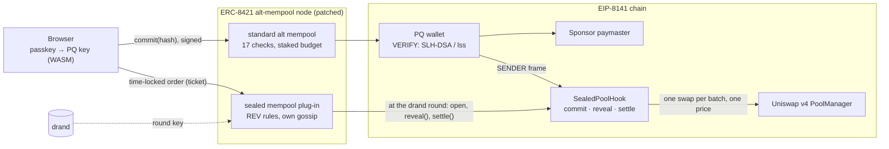

<div align="center">


# LeanSeal

### Sealed, quantum-safe swaps that bots can't touch

*EIP-8141 frame transactions · ERC-8421 alternative mempools · NIST SLH-DSA · drand timelock · Uniswap v4 hooks*


**[Live site](https://leanseal.vercel.app/)** · **[Console](https://129-212-188-106.sslip.io/dashboard)** · **[Submission references](ef.md)** · **[Uniswap v4 design](uniswap-use-description.md)** · **[Sealed-mempool rules](docs/leanseal-mempool.md)** · **[Devnet explorer](https://explorer.altmempool.wtf/)**

</div>

---

## What is LeanSeal?

Every swap on Ethereum is announced before it happens. Your signed transaction waits in a public mempool, bots read it, buy just before you and sell just after, and you lose up to your whole slippage. We measured **−3.0%** on our own chain. The key that signed it, an ordinary ECDSA key, won't survive a large quantum computer either.

LeanSeal fixes both, on public rails, with no private relay and no trusted middleman:

- **A quantum-safe wallet.** The account verifies a NIST post-quantum signature (SLH-DSA, ~154k gas) inside its EIP-8141 VERIFY frame. That's over the public mempool's 100k cap, so it travels through the **ERC-8421 alt mempool**.
- **A sealed lane.** Only a hash of the order goes on chain. The order itself is time-locked to a drand round and carried by our **custom ERC-8421 mempool**, which reveals it on schedule.
- **A fair finish, enforced in the EVM.** A **Uniswap v4 hook** fills each batch at **one price per side** and rejects every other swap, so there's nothing to trade around.

> Same swap, same bot: **−3.0%** in the public mempool, **0%** through LeanSeal, locally and on the live devnet, with every front-run rejected by the pool.

Users sign in with **Face ID / Touch ID**: the quantum-safe key is made in the browser and never leaves it. The first transaction creates the wallet with **gas paid by a sponsor**, so nobody needs ETH to start. **Institutions** get a desk view with an order ticket for sealed block trades.

---

## Try it

1. Open the **[console](https://129-212-188-106.sslip.io/dashboard)** in Chrome or Safari.
2. **Create passkey** (sidebar), then **Create my wallet (free)**: one transaction, sponsored gas.
3. **Swap with my wallet → Run.** Watch the Log: signed in your browser → commit (a hash only) → the bot's front-run **blocked** → the batch settles at one price.
4. **Transactions** tab: open your commit on the explorer. **Checks** tab: the ERC-8421 rule-by-rule report. **Sealed mempool** tab: look up your sealed order.
5. **View → Institution:** **Get test funds**, place a buy or sell order, **Withdraw vault**.

No funds needed: gas is sponsored and new wallets are funded on the devnet.

---

## How it works



### One node, two mempools
We **patched** the EF team's ERC-8421 alt-mempool node and **built one new mempool** that runs inside it.

| | Standard alt mempool | Sealed mempool |
|---|---|---|
| Made by | the EF alt-mempool team ([`mempool-workshop-sidecar`](https://github.com/forshtat/mempool-workshop-sidecar)); we patched it | us ([`leanseal-node/`](leanseal-node/src/mempool.ts)), loaded through the `customMempools` hook we added |
| Carries | signed frame transactions: the commit (a hash), wallet creation, deposits | sealed orders (tickets), locked until their drand round |
| Checks | simulates each transaction against the 17 ERC-8421 rules | can't read the order, so checks it against the chain: a matching paid commit, the right pool, a sensible deadline, no duplicates, a per-peer rate limit ([REV-010…060](leanseal-node/src/reveal.ts)) |
| Then | hands it to the block producer | holds and gossips it, opens it at the drand round, calls `reveal()` and `settle()` |

The public half of a swap (a hash) goes through the standard alt mempool; the private half (the order) goes through the sealed mempool. The chain joins them: a reveal only counts if it matches the hash.

---

## Features

### Quantum-safe wallet
- An EIP-8141 account reads its signature with `SIGDATACOPY`, checks it against the protocol sighash, then calls `APPROVE`. Built on the [SPHINCs-](https://github.com/nconsigny/SPHINCs-) verifiers: **NIST SLH-DSA-SHA2** (~154k gas, staked) and **leanSphincs-s** (~47k, fits 100k unstaked).
- A faster SLH-DSA signer ([`signer/`](signer)): **3 s** per signature instead of 354 s, byte-identical output.
- Code: [`contracts/src/vendor/sphincs`](contracts/src/vendor/sphincs) · [`contracts/src/LeanSealCloneAccount.sol`](contracts/src/LeanSealCloneAccount.sol)

### One-transaction onboarding
- A new user's first frame transaction deploys the wallet, verifies the PQ signature, has a **sponsor paymaster** pay the gas, and makes the first deposit.
- Wallets are EIP-1167 clones with the public key appended to the bytecode, so creation costs ~412k state gas instead of ~2.7M. The address is known in advance.
- Code: [`LeanSealFactory.sol`](contracts/src/LeanSealFactory.sol) · [`onboard.ts`](workshop/src/onboard/onboard.ts)

### Passkey wallet
- **The passkey unlocks the key; it doesn't sign.** WebAuthn's PRF gives a 32-byte secret, HKDF turns it into a seed, and our Rust signer, compiled to a **67 KB WASM** file, builds the leanSphincs-s key in the browser (~0.3 s) and signs in ~30 ms. The key is never stored.
- The server only receives signatures and checks each one with the native verifier before using it.
- Code: [`passkey.ts`](web/src/scripts/passkey.ts) · [`signer-lss-wasm`](signer-lss-wasm/src/lib.rs) · [`remote-signer.mjs`](demo/remote-signer.mjs)

### Sealed batch auction on Uniswap v4
- `commit(hash)` → `reveal()` → `settle()` in rounds of 4 blocks. `settle()` uses `PoolManager.unlock` and flash accounting to net buys against sells, swap only the remainder, and pay **one price per side**. Orders that miss their limit are refunded.
- **`beforeSwap` always reverts (`OutsideSwap`)**, so a bot's front-run fails in the EVM, whoever submits it.
- The hook's address is mined with CREATE2 to carry exactly the beforeSwap flag.
- Code: [`SealedPoolHook.sol`](contracts/src/SealedPoolHook.sol) · [tests](contracts/test/SealedPoolHook.t.sol) · [`batch_swap.ts`](workshop/src/batch/batch_swap.ts) · design: [`uniswap-use-description.md`](uniswap-use-description.md)

### Sealed mempool (custom ERC-8421 mempool)
- Published rules; the mempool ID is the IPFS CID of the [rules document](docs/leanseal-mempool.md): `QmSjNQxct8kRXMYKSsdefPsi3AFBHdSj3QjQtanS6bwgSc`.
- Its own gossip topic between nodes; every ticket gets a pass/fail report per rule.
- Keepers on each node reveal and settle at the drand round; a peer that got there first counts as done.
- Code: [`mempool.ts`](leanseal-node/src/mempool.ts) · [`reveal.ts`](leanseal-node/src/reveal.ts) · [`hookChain.ts`](leanseal-node/src/hookChain.ts) · drand timelock: [`envelope.ts`](sealing-kit/src/envelope.ts)

### Patched alt-mempool node
- **BUDGET-010:** staked entities get up to 1M verification gas instead of 100k. [`frameTx.ts`](sidecar/packages/executor/src/services/UserOpValidation/validators/frameTx.ts) · [patch](patches/sidecar-budget-010.patch)
- **CALLING-040:** precompiles `0x01`–`0x11` allowed, so the NIST verifier's SHA-256 call passes.
- **`customMempools`:** a plug-in point for non-standard mempools, plus a `custom_mempool_v1` gossip topic. [`customMempools.ts`](sidecar/packages/api/src/customMempools.ts) · [`CustomMempoolGossip.ts`](sidecar/packages/executor/src/services/CustomMempoolGossip.ts)

### Console
- **Individual** view: pick a scenario (protected swap, or the bot-attack contrast) and watch it live.
- **Institution** view: an order ticket for sealed block trades (buy or sell, amount, limit), vault balances, a test-funds faucet and withdraw.
- Tabs: **Run** (log, result, transactions), **Checks** (ERC-8421 admission reports), **Sealed mempool** (rules, orders, ticket lookup), **Wallets**, **Settings**.
- Code: [`server.ts`](demo/server.ts) · [`dashboard.ts`](web/src/scripts/dashboard.ts)

---

## Results

### Same swap, three routes (local chain, bot watching)
| | Public mempool | Encrypted until a deadline | **Sealed batch auction** |
|---|---|---|---|
| The bot saw | the whole swap | the whole swap, once released | only a hash |
| The bot did | sandwiched it | sandwiched it after release | tried to front-run → **rejected by the pool** |
| **Loss** | **−3.0%** | **−3.0%** | **0%** |

Hiding a swap until a deadline isn't enough. Taking away the "before" and "after" is what works.

### Admitted on the live devnet
| What | Transaction |
|---|---|
| Sealed batch commit, sponsored gas, bot rejected, 0% loss | [`0x923274a9…e1e5`](https://explorer.altmempool.wtf/tx/0x923274a91d03128b447f7e56d5b35262520fc21eee00229e570c68e49d71e1e5?node=https%3A%2F%2Faltmempool.forshtat.com%2Frpc) (block 6395) |
| Passkey wallet created in one transaction (real Touch ID) | [`0xcb71bb91…cd97`](https://explorer.altmempool.wtf/tx/0xcb71bb91ba0aa148e60fbd15cb77913091c9cde2a094d725686eb7956d3ccd97?node=https%3A%2F%2Faltmempool.forshtat.com%2Frpc) (block 6724) |
| Passkey wallet's sealed commit, 0% loss | [`0x8f8abafd…4647`](https://explorer.altmempool.wtf/tx/0x8f8abafdef9580b160b7752353e1f7efefd8cbd30324bab8bc628aae75bd4647?node=https%3A%2F%2Faltmempool.forshtat.com%2Frpc) (block 6430) |
| NIST SLH-DSA wallet, 200k verification budget | [`0xeb569198…4d13`](https://explorer.altmempool.wtf/tx/0xeb569198ae239d241ea5630d82f20230180f89ca972a7fa1753963f03bc13d4c?node=https%3A%2F%2Faltmempool.forshtat.com%2Frpc) (block 5463) |
| Staked leanSphincs-s wallet, 1M verification budget | [`0xdf844822…19db`](https://explorer.altmempool.wtf/tx/0xdf844822708d212cea3836715241887899d1bb47e34e22cf2a37d2d7b37d19db?node=https%3A%2F%2Faltmempool.forshtat.com%2Frpc) (block 2370) |

More transactions, contract addresses and code links: [`ef.md`](ef.md).

### Signatures
| | NIST SLH-DSA-SHA2 | leanSphincs-s |
|---|---|---|
| Standard | NIST FIPS 205 family | research, unaudited |
| Verification gas | ~154k (needs the staked alt-mempool budget) | ~47k (fits 100k unstaked) |
| Signature size | 3,856 B | 4,164 B |
| Signing | ~3 s (our signer) | ~30 ms (in the browser) |

A cheaper check doesn't make the whole swap cheaper: a ~4 KB signature is dominated by calldata cost.

---

## Run it locally

Needs macOS or Linux, Node 20+, [Bun](https://bun.sh) 1.2.23, [Foundry](https://getfoundry.sh), Rust, a C compiler and Docker.

```sh
# 1. contracts and signers
cd contracts && forge install foundry-rs/forge-std --no-git && forge build && cd ..
cd signer && make && cd ..
cd signer-lss && cargo build --release && cp target/release/lssk lssk && cd ..
cd signer-lss-wasm && cargo build --release --target wasm32-unknown-unknown \
  && cp target/wasm32-unknown-unknown/release/lss_wasm.wasm ../web/public/lss.wasm && cd ..

# 2. local EIP-8141 chain (ethrex + Lighthouse) and deployments
localnet/reset.sh
SPHINCS_OUT=$PWD/contracts/out localnet/deploy.sh

# 3. alt-mempool node with the sealed mempool plug-in
cd sidecar && bun install --frozen-lockfile && bun run build && cd ..

# 4. console
cd web && npm install && npm run build && cd ..
cd demo && npx --prefix ../workshop tsx server.ts     # http://localhost:4321/dashboard
```

Node configs, the batch pool and the onboarding contracts are set up with the scripts in [`workshop/src/batch`](workshop/src/batch) and [`workshop/src/onboard`](workshop/src/onboard). Passkeys need a site name, so open the console at `localhost`, not `127.0.0.1`.

---

## Security & trust

- **Research prototype, unaudited.** leanSphincs-s is research cryptography; SLH-DSA-SHA2 is the NIST family.
- **Keys stay with the user.** The passkey wallet's key is made and kept in the browser, never stored or sent. Our server holds only devnet keys: the keepers, the funding key and the sponsor.
- **No private submission.** Commits, reveals and settlements are public transactions; sealed orders are gossiped between nodes.
- **The node can't steal or change an order.** Funds sit in the hook's vault, a reveal must match the committed hash, and the pool rejects outside swaps. What a node controls is timing: if no one reveals, the order is skipped and the money stays in the vault.
- **drand** is BLS-based, so the time-lock isn't post-quantum, but it only has to hold for about 30 seconds.
- Secrets are gitignored (`.secrets/`, `*.seed`, `*.key.json`, node configs).

---

## License

No license file yet for LeanSeal's own code. Vendored code keeps its upstream licenses: [SPHINCs-](contracts/src/vendor/sphincs/LICENSE) (MIT), [SPHINCS+ reference](signer/LICENSE.upstream), [leanSphincs](signer-lss/LICENSE.upstream) (MIT), [mempool sidecar](sidecar/LICENSE), [DM Sans](web/public/fonts/OFL.txt) (OFL).

---

<div align="center">
<sub>Built on <a href="https://eips.ethereum.org/EIPS/eip-8141">EIP-8141</a> · <a href="https://docs.altmempool.wtf/">ERC-8421 alt mempool</a> · <a href="https://github.com/forshtat/mempool-workshop-sidecar">mempool sidecar</a> · <a href="https://github.com/lambdaclass/ethrex">ethrex</a> · <a href="https://github.com/nconsigny/SPHINCs-">SPHINCs-</a> · <a href="https://github.com/drand/tlock-js">tlock-js</a> · <a href="https://docs.uniswap.org/contracts/v4/overview">Uniswap v4</a> · <a href="https://astro.build">Astro</a></sub>
</div>
